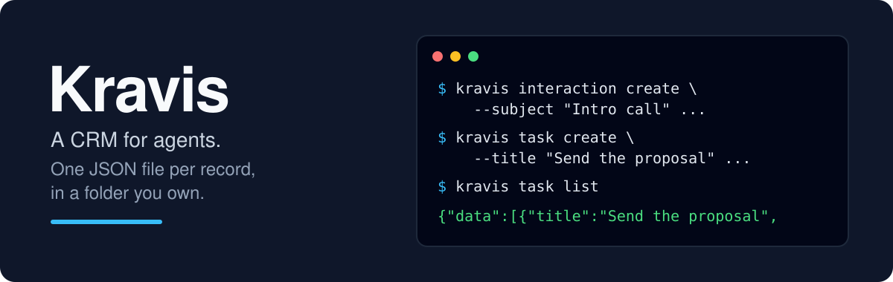
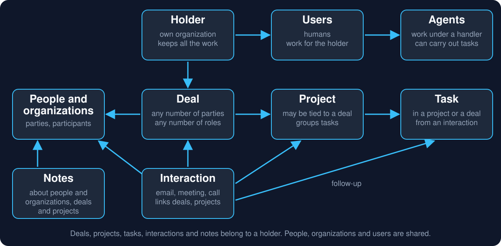

<h1 align="center"></h1>

<p align="center">
  <a href="https://github.com/diegomarino/kravis/releases/latest"></a>
  <a href="https://github.com/diegomarino/kravis/actions/workflows/ci.yml"></a>
  
</p>

Kravis is a CRM for agents. Agents and the people they work for use it to record and follow relationships and work, in files they own: one JSON file per record, in a folder you can read, diff and keep in git.

Today it covers people, organizations, users, interactions (emails, meetings, calls), the tasks that follow from them, and deals, projects and notes.

## Why Kravis

- **Local.** Records are plain JSON files in a folder you own: read them, `grep` them, review them in a pull request, keep them in git. There is no database and no service to run.
- **Agents first.** Off a terminal, every command prints one JSON object, and an error carries a hint for what to try next. A skill teaches your agent the commands. Each agent is a user with its own identity and works under a human, its handler, who answers for it.
- **No one-to-one limits.** The model guarantees that:
  - a deal is not tied to one party: it has any number of parties, people or organizations, each with any number of party roles, and it records the holder's own party role;
  - a person is not tied to one organization: a person has any number of affiliations, at most one per organization;
  - an interaction is not tied to one deal: it concerns any number of deals and projects at once, and its participants are people or organizations;
  - a note is not tied to one record: it is about one or more people, organizations, deals and projects, in any mix.



## Install

The binary, with Go:

```sh
go install github.com/diegomarino/kravis/cmd/kravis@latest
```

Or download one for macOS or Linux from [Releases](https://github.com/diegomarino/kravis/releases). Check it with `kravis --version`.

The skill, so your agent knows the commands, the flags and what to do on an error:

```sh
npx skills add diegomarino/kravis --skill kravis
```

Then ask it in plain words: "log my call with Ben and remind me to send the proposal on Monday".

## What it manages

Every type has `create`, `list`, `get`, `update` and `delete`; the table lists what each adds. `kravis schema <type>` prints a type's fields, flags and catalogs.

| Record | What it is | Try |
|---|---|---|
| People | An individual you keep a relationship with, found by email | `kravis person create --name <name> --email <email>`, `kravis person affiliation add <person> <organization>` |
| Organizations | A company or other group, found by domain | `kravis organization create --name <name> --domain <domain>` |
| Users and agents | Who writes records: humans, and agents that work under a human | `kravis user create <key> --agent --holder <org> --handler <user>`, `kravis whoami` |
| Interactions | An email, meeting or call, with its participants and deals | `kravis interaction create --channel <channel> --occurred-at <time> --subject <text> --participant <person> --deal <deal>` |
| Deals | A transaction with its parties, their party roles and a stage | `kravis deal create --party <party> --role <role> --holder-role <role>`, `kravis deal party add <deal> <party>`, `kravis deal stage <deal> <stage>` |
| Projects | Work that groups tasks, optionally tied to a deal | `kravis project create --name <name> --deal <deal>`, `kravis project close <project>` |
| Tasks | A piece of work with a human assignee, often a follow-up | `kravis task create --title <title> --assignee <user> --due <date>`, `kravis task status <task> <status>`, `kravis task list --overdue` |
| Notes | Free text about people, organizations, deals or projects | `kravis note create --subject <id> --text-file <file>` |

`kravis check` validates a workspace. The full contract is in [`docs/cli.md`](docs/cli.md).

## Five-minute quickstart

In an empty folder:

```sh
kravis init --timezone Europe/Madrid --organization "Acme Advisory" --user ana --user-name "Ana Ruiz"
kravis user create "scout" --agent --holder org_acme-advisory --handler us_ana --name "Scout"
kravis person create --name "Ben Carter" --email ben@example.com
kravis interaction create --channel email --occurred-at 2026-11-23T10:00:00Z --subject "Intro call" --participant ben@example.com --ref email:message:intro-001@example.com
kravis task create --title "Send the proposal" --assignee us_ana --interaction it_2026-11-23-intro-call --due 2026-12-01
kravis task list
```

`init` creates the workspace, your organization and you as its first user. The second line adds an agent that works under you. Then you record an interaction with a person and create the follow-up it calls for. `task list` shows it, by due date:

```json
{"data":[{"id":"tk_01m89ttyx2fssbxh4xhq07yj7v","title":"Send the proposal","live":true,"holder":"org_acme-advisory","status":"todo","category":"open","assignee":"us_ana","due":"2026-12-01"}],"filters":{"holder":"org_acme-advisory"},"total":1,"next_cursor":null}
```

The task ID is generated, so yours differs.

This leaves the following on disk. It is an excerpt: the other agent's user file and a `keys/` folder, which keeps creates safe to repeat, are left out.

```text
.
├── kravis.json
├── config.json
└── records/
    ├── users/us_ana.json
    ├── organizations/org_acme-advisory.json
    ├── people/pe_ben-carter.json
    ├── interactions/2026-11/it_2026-11-23-intro-call.json
    └── tasks/2026-11/tk_01m89ttyx2fssbxh4xhq07yj7v.json
```

One record, one file. Long text goes in a Markdown file next to it. [`docs/storage.md`](docs/storage.md) has the whole layout.

## More

- [`docs/cli.md`](docs/cli.md): the commands, output, errors and exit codes.
- [`docs/storage.md`](docs/storage.md): the files on disk.
- [`docs/development.md`](docs/development.md): stack, tooling and releases.
- [`GLOSSARY.md`](GLOSSARY.md): the words Kravis uses.
