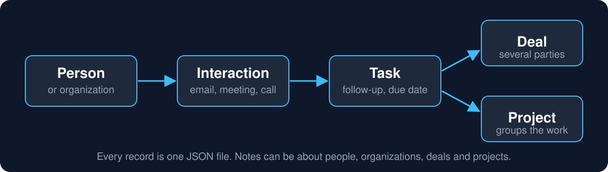

<h1 align="center"></h1>

<p align="center">
  <a href="https://github.com/diegomarino/kravis/releases/latest"></a>
  <a href="https://github.com/diegomarino/kravis/actions/workflows/ci.yml"></a>
  
</p>

Kravis is a CRM for agents. Agents and the people they work for use it to record and follow relationships and work, in files they own: one JSON file per record, in a folder you can read, diff and keep in git.

Today it covers people, organizations, users, interactions (emails, meetings, calls), the tasks that follow from them, and deals, projects and notes.

## Why Kravis

- **Your files, no service.** Records are plain JSON in a folder. Read them, `grep` them, review them in a pull request. There is no database to run.
- **Built to be called by an agent.** Off a terminal, every command prints one JSON object, and an error says what to try next. `--output json` forces it on a terminal.
- **Humans and agents share one workspace.** Each agent works under a person, and every record says who made it.



## Install

```sh
go install github.com/diegomarino/kravis/cmd/kravis@latest
```

Or take the `v0.2.0` binary for macOS or Linux (it needs no Go):

```sh
os=$(uname -s | tr A-Z a-z); arch=$(uname -m | sed 's/x86_64/amd64/; s/aarch64/arm64/')
curl -sL "https://github.com/diegomarino/kravis/releases/download/v0.2.0/kravis_0.2.0_${os}_${arch}.tar.gz" | tar xz kravis
```

Move `kravis` onto your `PATH` and check it with `kravis --version`. All builds are on [Releases](https://github.com/diegomarino/kravis/releases).

## Five-minute quickstart

In an empty folder:

```sh
kravis init --timezone Europe/Madrid --organization "Acme Advisory" --user ana --user-name "Ana Ruiz"
kravis user create "scout" --agent --holder org_acme-advisory --handler us_ana --name "Scout"
kravis person create --name "Ben Carter" --email ben@example.com
kravis interaction create --channel email --occurred-at 2026-11-23T10:00:00Z --subject "Intro call" --participant ben@example.com --ref email:message:intro-001@example.com
kravis task create --title "Send the proposal" --assignee us_ana --interaction it_2026-11-23-intro-call --due 2026-12-01
kravis task list
```

`init` creates the workspace, your organization and you as its first user. The second line adds an agent that works under you. Then you record an interaction with a person and create the follow-up it calls for. `task list` shows it, by due date:

```json
{"data":[{"id":"tk_01m89ttyx2fssbxh4xhq07yj7v","title":"Send the proposal","live":true,"holder":"org_acme-advisory","status":"todo","category":"open","assignee":"us_ana","due":"2026-12-01"}],"filters":{"holder":"org_acme-advisory"},"total":1,"next_cursor":null}
```

The task ID is generated, so yours differs.

## What it leaves on disk

An excerpt: the other agent's user file and a `keys/` folder, which keeps creates safe to repeat, are left out.

```text
.
├── kravis.json
├── config.json
└── records/
    ├── users/us_ana.json
    ├── organizations/org_acme-advisory.json
    ├── people/pe_ben-carter.json
    ├── interactions/2026-11/it_2026-11-23-intro-call.json
    └── tasks/2026-11/tk_01m89ttyx2fssbxh4xhq07yj7v.json
```

One record, one file. Long text goes in a Markdown file next to it. [`docs/storage.md`](docs/storage.md) has the whole layout.

## Use it from an agent

Install the skill and your agent learns the commands, the flags and what to do on an error:

```sh
npx skills add diegomarino/kravis --skill kravis
```

Then ask it in plain words: "log my call with Ben and remind me to send the proposal on Monday".

## More

- [`docs/cli.md`](docs/cli.md): the commands, output, errors and exit codes.
- [`docs/storage.md`](docs/storage.md): the files on disk.
- [`docs/development.md`](docs/development.md): stack, tooling and releases.
- [`GLOSSARY.md`](GLOSSARY.md): the words Kravis uses.
